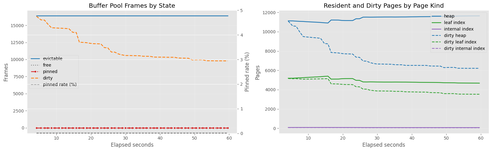
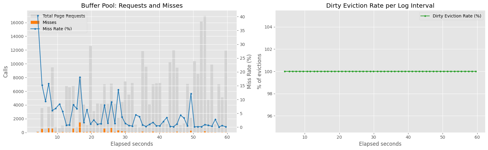
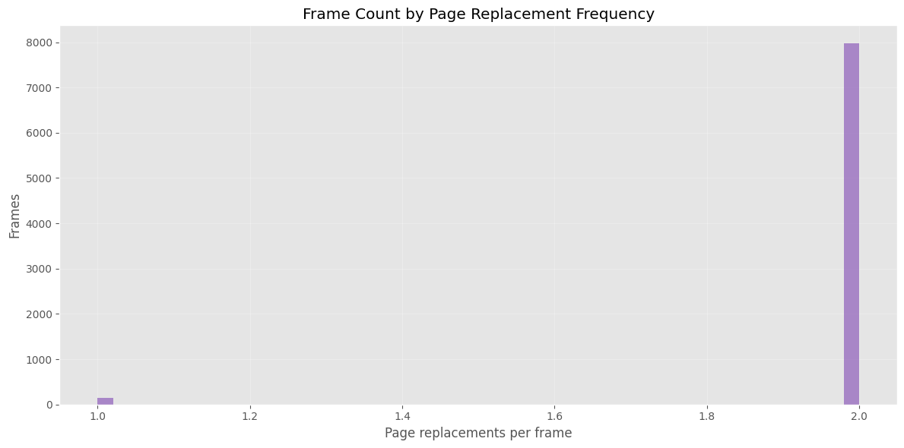
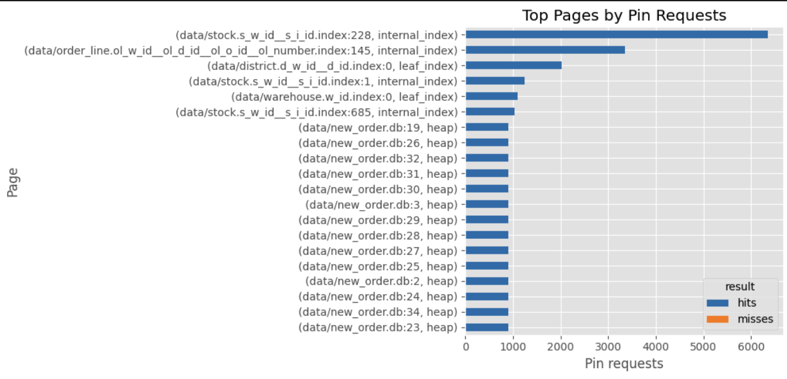

# Background

From the [previous result](./2026-06-analyze-naive-eviction-policy), we observed that dirty write-back should not be the primary objective of the replacement policy, because an aggressive clean-first bias can break locality.

Production RDBMSs usually separate these concerns: the replacement policy mainly focuses on reuse/locality, while dirty page write-back is handled by background writing, cleaning, and checkpointing.

First, I will implement [ARC](https://www.usenix.org/legacy/events/fast03/tech/full_papers/megiddo/megiddo.pdf) and compare it with both the original clean-first circular policy and the no-clean-bias circular policy.

# Result

transaction throughput decreased from 4.28 to 3.10.

