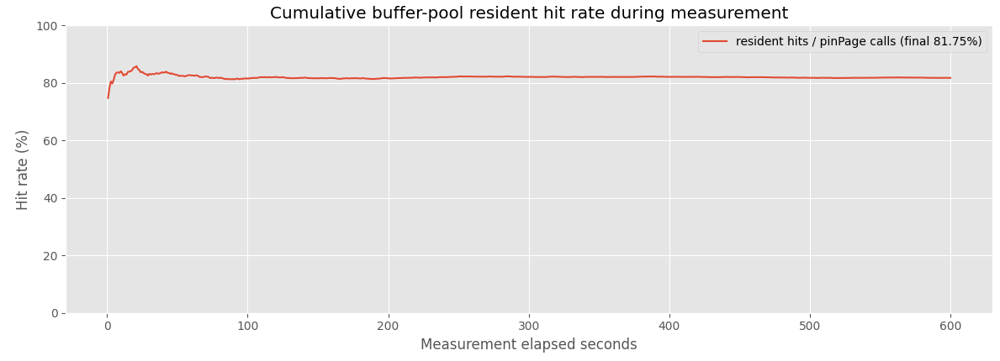
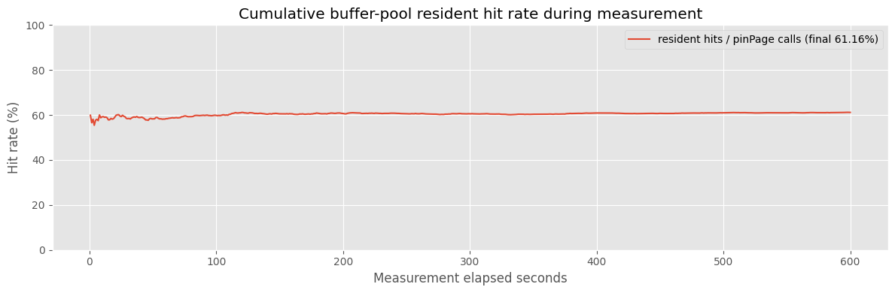
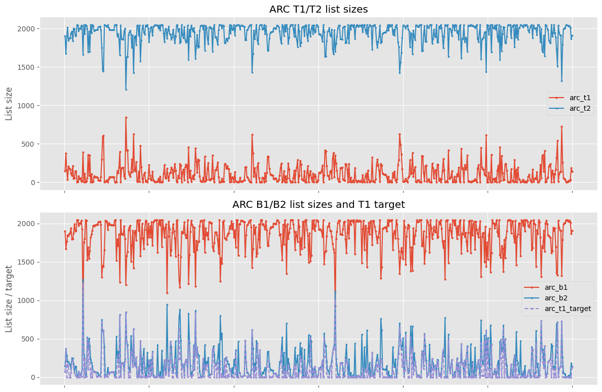

# Background

In the [previous experiment](./2026-06-analyzing-a-naive-clean-first-buffer-pool-replacement-policy.md), disabling the clean-first bias increased transaction throughput from 2.83 to 4.28. Visual inspection of the graphs also showed that the average miss rate decreased from approximately 15% to 2.5%.

Based on this result, I implemented [ARC](https://www.usenix.org/legacy/events/fast03/tech/full_papers/megiddo/megiddo.pdf) to prioritize page reuse over avoiding dirty-page write-back. ARC dynamically balances recency and frequency. This note compares ARC with the circular replacement policy without a clean bias.

# Experimental setup

The buffer pool contained 2,048 frames. Each run used one terminal, a Zipf skew factor of 0.99, a 180-second warmup, a 600-second measurement period, and a configured arrival rate of 100 requests per second. Both workloads were read-only.

- Baseline workload: 20,000 records and 100% point reads
- Heavy workload: 50,000 records, 90% point reads, and 10% scans

The heavy workload increased the dataset size while keeping the buffer pool fixed and introduced scans at the same time.

# Results

| Workload | Replacement policy | Throughput (req/s) | Average point read (ms) | Average scan (ms) | Final hit rate |
| --- | --- | ---: | ---: | ---: | ---: |
| Baseline | ARC | 85.427 | 11.736 | N/A | 94.52% |
| Baseline | Circular | 85.185 | 11.749 | N/A | 91.84% |
| Heavy | ARC | 91.997 | 7.887 | 38.223 | 81.75% |
| Heavy | Circular | 86.856 | 8.054 | 44.394 | 61.16% |

With the baseline workload, the throughput difference between ARC and circular was 0.28%, and the hit-rate difference was 2.68 percentage points. With the heavy workload, the throughput difference increased to 5.92% and the hit-rate difference increased to 20.59 percentage points. ARC's average scan latency was also 13.90% lower than circular's.

ARC cumulative hit rate under the heavy workload:

Circular cumulative hit rate under the heavy workload:

In ARC's internal state under the heavy workload, `T2` remained larger than `T1` throughout the measurement period and stayed close to 2,048 in many samples.

# Discussion

The baseline workload consisted entirely of point reads and had strong locality, so the circular policy could retain hot pages and the difference from ARC was small. With the heavy workload, the larger dataset and added scans may have increased cache pollution. ARC's frequency-aware behavior may have retained hot pages more effectively, resulting in a larger difference in hit rate and throughput.

These are single-run measurements intended to show the overall trend, not a rigorous performance evaluation. Because the dataset size and operation mix changed at the same time, this experiment does not isolate which change contributed most to the larger difference.
