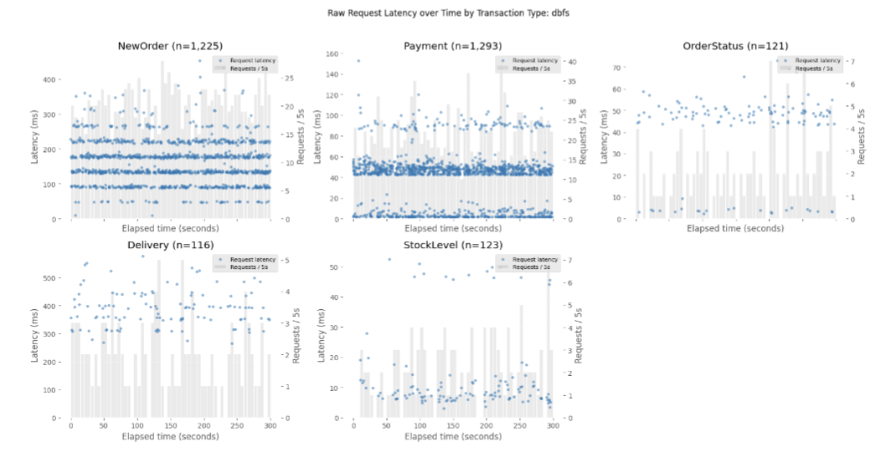
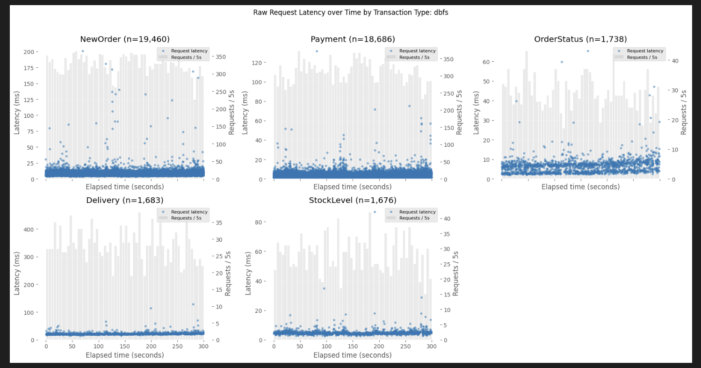

# Finding and Fixing Quantized TCP Latency

## Summary

TPC-C performance analysis revealed horizontal latency bands near multiples of
45 ms. They appeared across transaction types with different SQL shapes, so the
delay seemed to come from a shared part of the request path.

DBFS uses a small length-prefixed request/response protocol, and neither the
JDBC client nor the server enabled `TCP_NODELAY`. This matched the well-known
interaction between Nagle's algorithm and delayed ACKs. `TCP_NODELAY` was
therefore enabled on both endpoints, and the workload was measured again.

The bands almost disappeared. Throughput increased from 9.59 to 144.14 req/s,
and P95 latency fell from 278.10 to 15.30 ms.

## Observation

The pattern became clear after plotting each request instead of only looking at
aggregate percentiles. Before the change, requests clustered around repeated
latency levels:



Requests within 2 ms of a positive multiple of 45 ms accounted for 817 of
2,878 measured requests, or 28.39%.

## Change

The server sends each response as a 4-byte length followed by its JSON payload:

```text
send frame length
send payload
```

The JDBC client now enables `TCP_NODELAY` when connecting:

```java
newSocket.setTcpNoDelay(true);
```

The server also enables it on every accepted socket:

```cpp
int tcp_no_delay = 1;
setsockopt(client_fd, IPPROTO_TCP, TCP_NODELAY,
           &tcp_no_delay, sizeof(tcp_no_delay));
```

The option is set on both sides because the client sends requests and the
server sends responses.

## Result

| Metric | Before | With `TCP_NODELAY` | Change |
| --- | ---: | ---: | ---: |
| Measured requests | 2,878 | 43,243 | +1,402.5% |
| Throughput | 9.59 req/s | 144.14 req/s | 15.0x |
| Average latency | 104.03 ms | 6.92 ms | -93.3% |
| Median latency | 56.07 ms | 5.93 ms | -89.4% |
| P95 latency | 278.10 ms | 15.30 ms | -94.5% |
| P99 latency | 436.97 ms | 22.56 ms | -94.8% |

The improvement appeared in every transaction type:

| Transaction | Before P95 | With `TCP_NODELAY` P95 |
| --- | ---: | ---: |
| NewOrder | 264.27 ms | 12.66 ms |
| Payment | 89.63 ms | 7.35 ms |
| OrderStatus | 56.93 ms | 11.02 ms |
| Delivery | 521.12 ms | 26.83 ms |
| StockLevel | 47.56 ms | 6.85 ms |

After the change, only 10 of 43,243 requests, or 0.023%, fell near the same
45 ms multiples:

