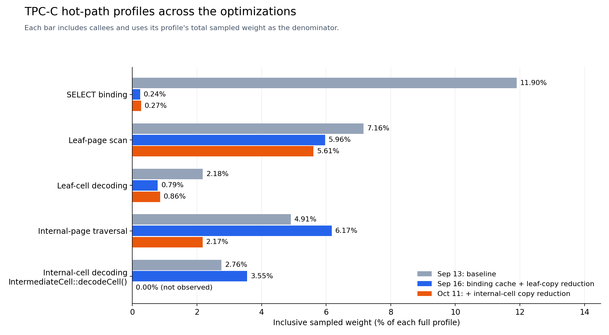

# Optimizing TPC-C Binding and B-tree Traversal

## Summary

Repeated binding preparation and key copies during B-tree traversal were
reduced in the TPC-C execution path. Binding preparation was cached by SQL
template, and leaf traversal was changed to avoid full-cell decoding and
copies. The same approach was then applied to internal-page traversal.

With the binding cache and leaf-traversal changes applied, dbfs throughput
improved from 304.13 to 341.45 requests per second (+12.3%), while average
latency fell from 3.277 to 2.918 ms (-11.0%). The profiles also showed smaller
shares for the targeted binding and leaf-cell decoding work.

In the flamegraph after the internal-page change, traversal's sampled share fell
from 6.17% to 2.17%, and `IntermediateCell::decodeCell()` did not appear in
the captured stacks.

## Optimizations

### Cache prepared binding work

[Commit `56c8d1c`](https://github.com/yohaku999/oltp_fs/commit/56c8d1cd427286337aaf74dd13569be883258592)
introduced a `PreparedStatementCache` keyed by SQL template for SELECT, INSERT,
UPDATE, and DELETE. Table/schema resolution and preparation of column
references, predicates, and assignments are reused across executions.
Parameter values are still bound per execution, and read access paths and join
plans are still selected per execution.

### Avoid copies during B-tree leaf traversal

[Commit `1c3ae8d`](https://github.com/yohaku999/oltp_fs/commit/1c3ae8d4d8c6038b428f8cfaedff3cfc06a9bf0f)
reduced copies by passing scan boundaries by const reference, reading leaf
keys through `LeafCell::keyView()` without constructing a full cell, reading
RIDs directly, and moving collected entries between vectors. Matching result
entries still own their keys.

### Avoid copies during internal-page traversal

[Commit `fa45f5a`](https://github.com/yohaku999/oltp_fs/commit/fa45f5a465a539227464421c2c61aaebd7ec618e)
applied the same approach to internal cells: separator keys are read through
`IntermediateCell::keyView()` and child IDs through `readPageID()`. Child
selection and leftmost-child lookup avoid constructing cells with owned key
strings.

## Measurement conditions

Throughput measurements and flamegraph captures used these common settings.

| Setting | Value |
| --- | --- |
| Workload | TPC-C, scale factor 1 |
| Terminals | 1 |
| Random seed | 42 |
| Transaction weights | `45,43,4,4,4` |
| Warmup | 60 seconds |
| Measurement interval | 300 seconds |
| Request rate | Target 10,000 req/s, effectively unlimited for both engines |
| dbfs buffer capacity | 128 MiB (4 KiB pages × 32,768 frames) |
| dbfs buffer-pool initialization | Reset at the start of warmup |
| Buffer-pool logging | Disabled |

Each measurement corresponds to the following purpose and implementation state.

| Date | Purpose | Implementation state |
| --- | --- | --- |
| September 13 | Throughput measurement and flamegraph capture | Before the binding cache and leaf-traversal copy reductions |
| September 16 | Throughput measurement and flamegraph capture | Binding cache + leaf-traversal copy reductions |
| October 11 | Flamegraph capture | Both changes, plus the internal-cell `keyView()` / `readPageID()` path |

## Results

The table shows throughput and latency before and after introducing the
binding cache and leaf-traversal copy reductions.

| Implementation state and mode (date) | Engine | Throughput | Average latency | P95 latency |
| --- | --- | ---: | ---: | ---: |
| Before changes, throughput (September 13) | dbfs | 304.13 req/s | 3.277 ms | 8.608 ms |
| Before changes, throughput (September 13) | PostgreSQL | 532.72 req/s | 1.868 ms | 5.037 ms |
| Binding cache + leaf-copy reduction (September 16) | dbfs | 341.45 req/s | 2.918 ms | 7.361 ms |
| Binding cache + leaf-copy reduction (September 16) | PostgreSQL | 540.41 req/s | 1.842 ms | 4.965 ms |

Between September 13 and September 16, dbfs P95 also fell by 14.5%, while
PostgreSQL throughput changed by about +1.4%.

## Profile evidence

The September throughput profiles support the binding and leaf-copy changes.
`binder::bindSelectQuery()` falls from 11.90% to 0.24% of inclusive sampled
weight, and `LeafCell::decodeCell()` from 2.18% to 0.79%.

On September 16, internal-page traversal still accounted for 6.17% and
internal-cell decoding for 3.55%. These remaining costs were targeted by
applying copy reductions to internal pages. In the October 11 flamegraph,
`InternalIndexPage::findChildPage()` accounted for 2.17%, and no captured
stack contained `IntermediateCell::decodeCell()`.

This figure compares the September 13, September 16, and October 11
profiles by summing the sampled weights of stacks containing each symbol and
dividing by each profile's total weight. A symbol is counted once per stack.
Each bar includes work in callees, so parent and child symbols share sample
weights.

The figure shows smaller shares for binding, leaf-cell decoding, and
internal-page traversal. This is consistent with reusing static preparation,
reducing leaf-cell copies, and switching internal-page child selection to
`keyView()` / `readPageID()`.

Child selection now reads and compares keys and reads child page IDs directly,
without constructing cells that own their key strings. `decodeCell()` is
still used for page compaction and cell transfers. The figure's 0.00% means
that this symbol was not observed in this capture.
