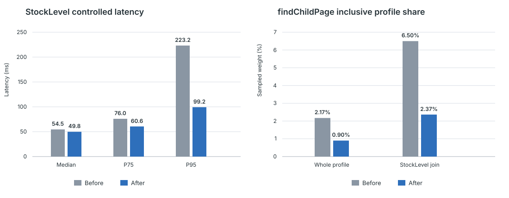
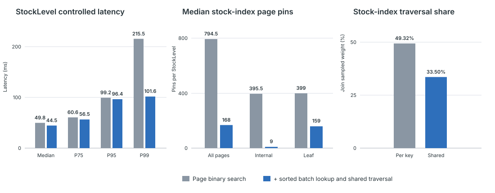

# Optimizing StockLevel B+tree Lookups

## Summary

Stock-index probes accounted for about 52% of the sampled weight beneath the
StockLevel join. We first replaced sequential page searches with binary
search. We then sorted and deduplicated the lookup keys for a batch of outer
rows and traversed the B+tree once for each shared range of keys.

The controlled measurements isolate these changes in sequence. Page-local
binary search reduced StockLevel median latency from 54.536 to 49.846 ms. The
shared traversal then reduced it to 44.484 ms. For the main
`COUNT(DISTINCT ...)` query, mean latency fell from 50.482 ms after binary
search to 38.854 ms after shared traversal. Median stock-index page pins fell
from 794.5 to 168 per StockLevel transaction.

## Changes

### Use binary search within pages

`InternalIndexPage::findChildPage()` and `LeafIndexPage::hasKey()` now narrow
the ordered slot directory with binary search and skip invalid slots when they
encounter them. Internal-page search keeps the existing routing rule: use the
last child whose separator equals the lookup key, otherwise use the first
greater separator, and use the rightmost child when neither exists.

### Sort lookup keys and share traversal

`IndexLookupJoinOperator` collects up to 512 outer rows, builds their lookup
keys, and sorts and deduplicates them. `BTreeCursor::findExactEntries()` routes
each key range through an internal page together and scans the resulting leaf
pages in key order. The join groups the matching inner rows by lookup key and
emits them in the original outer-row order.

## Results

### Binary search within pages

The common case improved modestly, while the upper part of the latency
distribution contracted more clearly.

| StockLevel latency | Before | After | Reduction |
| --- | ---: | ---: | ---: |
| P25 | 46.017 ms | 42.104 ms | 8.5% |
| Median | 54.536 ms | 49.846 ms | 8.6% |
| P75 | 75.962 ms | 60.591 ms | 20.2% |
| P95 | 223.243 ms | 99.215 ms | 55.6% |
| Maximum | 3,260.520 ms | 303.989 ms | 90.7% |

The main StockLevel query executed 50 times in both controlled runs. Its mean
also fell when the single slowest execution was removed, so the result is not
explained only by the previous maximum.

| `COUNT(DISTINCT ...)` query latency | Before | After | Reduction |
| --- | ---: | ---: | ---: |
| Mean | 151.543 ms | 50.482 ms | 66.7% |
| Mean excluding the maximum | 88.924 ms | 45.339 ms | 49.0% |
| Maximum | 3,219.909 ms | 302.549 ms | 90.6% |

### Sorted batch lookup and shared traversal

Compared with the page-level binary-search implementation, shared traversal
improved the middle of the StockLevel distribution and removed the remaining
long tail in this run.

| StockLevel latency | Binary search | Shared traversal | Reduction |
| --- | ---: | ---: | ---: |
| Mean | 57.066 ms | 48.123 ms | 15.7% |
| Median | 49.846 ms | 44.484 ms | 10.8% |
| P75 | 60.591 ms | 56.468 ms | 6.8% |
| P95 | 99.215 ms | 96.431 ms | 2.8% |
| P99 | 215.455 ms | 101.601 ms | 52.8% |
| Maximum | 303.989 ms | 102.387 ms | 66.3% |

The main query executed 50 times in the binary-search run and 53 times in the
shared-traversal run.

| `COUNT(DISTINCT ...)` query latency | Binary search | Shared traversal | Reduction |
| --- | ---: | ---: | ---: |
| Mean | 50.482 ms | 38.854 ms | 23.0% |
| Mean excluding the maximum | 45.339 ms | 37.696 ms | 16.9% |
| Maximum | 302.549 ms | 99.090 ms | 67.2% |

The number of distinct stock-index pages stayed almost the same, while page
pins fell sharply. This is the intended effect of sharing traversal across
sorted keys.

| Median stock-index access per StockLevel | Binary search | Shared traversal | Change |
| --- | ---: | ---: | ---: |
| Page pins | 794.5 | 168.0 | -78.9% |
| Internal-page pins | 395.5 | 9.0 | -97.7% |
| Leaf-page pins | 399.0 | 159.0 | -60.2% |
| Distinct pages | 165.0 | 166.5 | +0.9% |

## Profile evidence

For each folded stack, the profile metric counts a symbol once and sums that
stack's sample weight. Dividing the sum by the profile's total weight gives the
inclusive share shown below.

| `InternalIndexPage::findChildPage()` scope | Before | After | Reduction |
| --- | ---: | ---: | ---: |
| Whole profile | 2.17% | 0.90% | 58.5% |
| Within `IndexLookupJoinOperator::next()` | 6.50% | 2.37% | 63.6% |

The median stock-index access volume remained similar: 754 to 794.5 page pins
and 156 to 165 distinct pages per StockLevel transaction. The smaller latency
and profile share therefore match the intended mechanism: fewer separator
comparisons within the same per-key traversal pattern.

StockLevel uses `LeafIndexPage::findEntries()` on the leaf side, so its result
specifically validates the `findChildPage()` change. `LeafIndexPage::hasKey()`
is used by uniqueness checks elsewhere in TPC-C.

For the shared-traversal measurement, the stock-index path beneath
`IndexLookupJoinOperator::next()` changed from the per-key
`BTreeCursor::findEntries()` path to `BTreeCursor::findExactEntries()`. Using
the same profile metric, its share within the join fell from 49.32% to 33.50%.
Together with the page-pin counts, this shows that sorted keys reused the
internal and leaf pages reached by the same traversal ranges.

